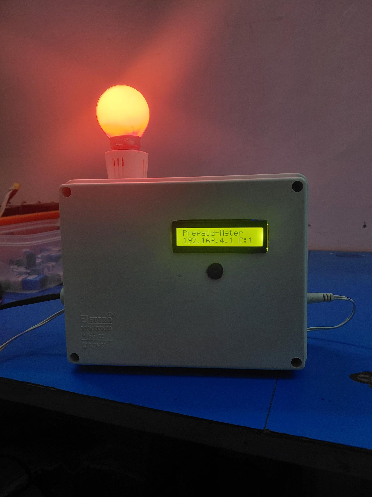
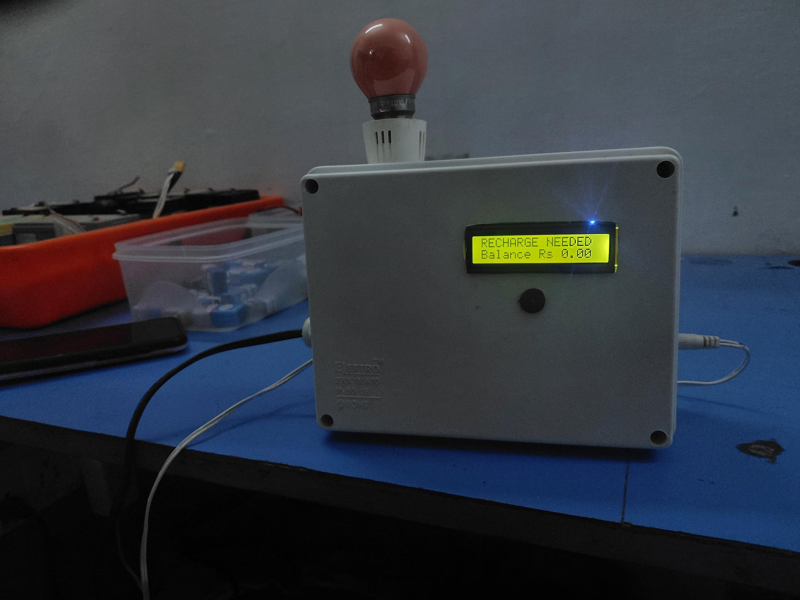
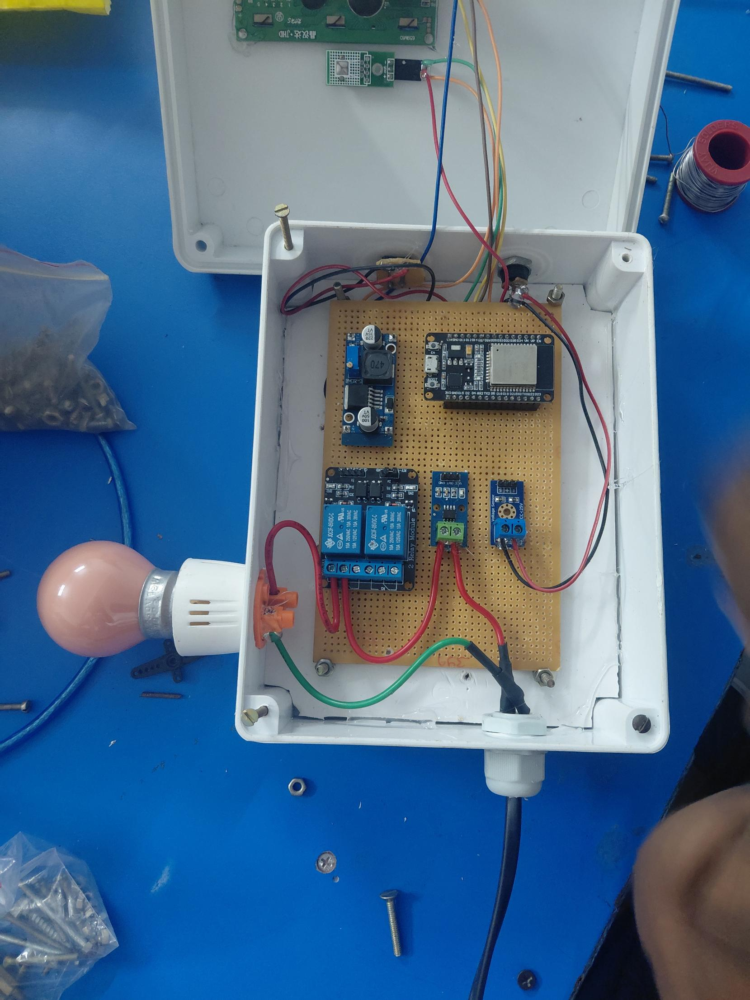
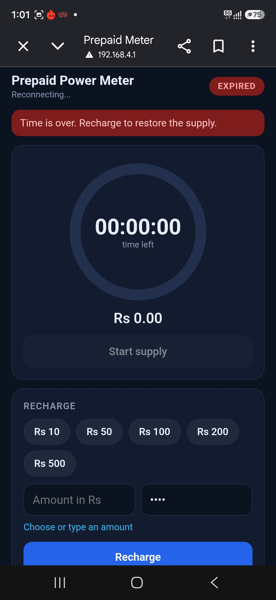
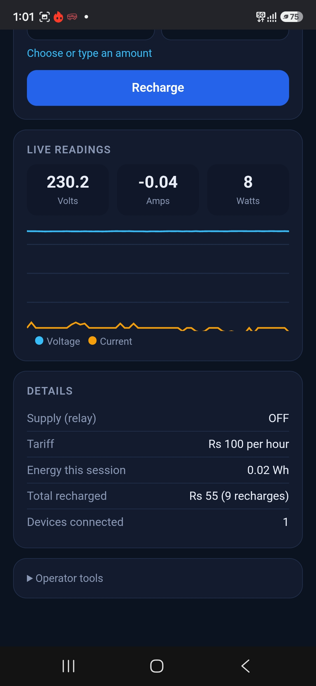
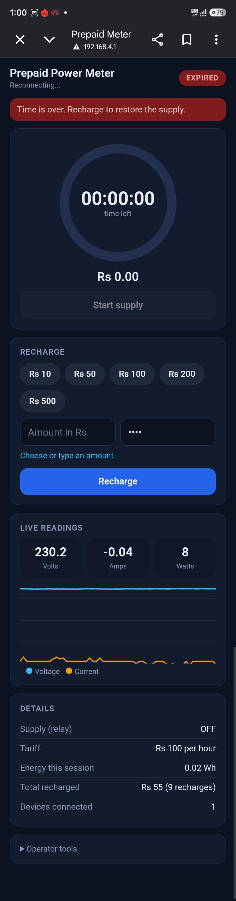

# IoT-Based Prepaid Energy Meter with Hotspot Dashboard Using ESP32

A prepaid power meter built around an ESP32. The user "recharges" an amount from a phone dashboard, and the ESP32 keeps a relay switched on for the paid time only (default: **Rs 100 = 1 hour**). When the time runs out, the relay cuts the supply and the system waits for the next recharge.

The ESP32 creates its **own WiFi hotspot**, so the dashboard works anywhere, with no router or internet.

| Supply on (lamp as load) | Recharge needed (supply cut) |
|:---:|:---:|
|  |  |

## Features

- **Prepaid by time**: Rs 100 = 1 hour (set by `RATE_RS_PER_HOUR`). The dashboard shows how much time an amount buys before you recharge.
- **Own WiFi hotspot** (`Prepaid-Meter`) with a captive-portal style redirect to the dashboard at `192.168.4.1`.
- **Interactive mobile dashboard**: countdown ring, balance, quick recharge buttons (Rs 10 to 500), custom amount, start/pause supply, live voltage and current graph, energy used, total recharged.
- **Relay cut-off** when the balance reaches zero, and automatic start after a recharge from zero.
- **Low-balance warning** at 5 minutes left, with a banner, a blinking LCD message and beeps.
- **Balance survives power cuts**: stored in the ESP32's flash every 30 seconds and on every recharge.
- **PIN-protected** recharge and clear-balance actions.
- **16x2 LCD** with 4 pages, and a push switch: short press = next page, hold 3 s = restart (balance is kept).

## Photos

  

Inside the enclosure: ESP32 DevKit, DC-DC buck converter, 2-channel relay module (one channel used), ACS712 current sensor and the 0-25 V voltage sensor module on a perfboard, with the 16x2 LCD on the lid.

### Dashboard (phone)

| Time over, recharge needed | Live readings and details | Full page |
|:---:|:---:|:---:|
|  |  |  |

## Hardware

| Component | Role |
|---|---|
| ESP32 DevKit (ESP32-D0WD-V3) | Main controller, WiFi hotspot, web server, flash storage |
| ACS712 current sensor | Measures the load current (sensor output on GPIO32) |
| 0-25 V voltage sensor module | Measures the voltage (output on GPIO35), see the notes below |
| 2-channel relay module (1 channel used) | Switches the load on and off |
| 16x2 LCD with I2C backpack (0x27) | Local display |
| Buzzer (active LOW module) | Recharge, low-balance and cut-off beeps |
| Push switch | LCD page change and restart |
| DC-DC buck converter | Steps the input supply down for the electronics |
| Lamp (bulb and holder) | Test load |
| ABS junction box (200 x 155 x 80 mm) | Enclosure |

### Pin map

| Function | ESP32 pin |
|---|---|
| Current sensor (ACS712 OUT) | GPIO32 |
| Voltage sensor (S) | GPIO35 |
| Relay IN | GPIO23 (active LOW) |
| Buzzer | GPIO18 (active LOW) |
| Push switch (to GND, internal pull-up) | GPIO14 |
| LCD SDA / SCL | GPIO21 / GPIO22 |

## How it works

1. The ESP32 starts the hotspot and the web server, and restores the saved balance from flash.
2. The user joins the hotspot, opens `http://192.168.4.1`, enters the PIN and a recharge amount.
3. The amount is converted to seconds (`amount x 3600 / rate`) and added to the balance. A recharge from zero starts the supply automatically.
4. The relay stays on while time is left and supply is running. Every second the balance counts down, and the sensors are read every 500 ms.
5. At 5 minutes left the buzzer beeps and a warning shows. At zero the relay switches off, the buzzer sounds, and the LCD and dashboard ask for a recharge.

### LCD pages (short press on the switch to change)

1. Balance (Rs) and time left, or `RECHARGE NEEDED`
2. Voltage and current
3. Tariff and supply (relay) state
4. Hotspot name, IP address and number of connected devices

### HTTP endpoints

| Endpoint | Method | Purpose |
|---|---|---|
| `/` | GET | Dashboard page |
| `/api/state` | GET | Live state as JSON |
| `/api/recharge` | POST | `amount`, `pin`: add time |
| `/api/toggle` | POST | Start or pause the supply |
| `/api/clear` | POST | `pin`: clear the remaining balance |

## Getting started

1. Install the **Arduino IDE** and add the **ESP32 board package** (Espressif).
2. Install the library **LiquidCrystal I2C** (by Frank de Brabander) from the Library Manager. The other libraries (`WiFi`, `WebServer`, `DNSServer`, `Preferences`, `Wire`) come with the ESP32 package. The Arduino IDE may warn that the LCD library targets AVR; it works on the ESP32.
3. Open `prepaid_meter/prepaid_meter.ino`, select your ESP32 board and port, and upload.
   - If the upload stops partway, lower **Upload Speed** to 115200 and unplug the relay and other modules while flashing.
4. Join the WiFi network `Prepaid-Meter`, then open `http://192.168.4.1`.

### Settings (top of the sketch)

| Constant | Default | Meaning |
|---|---|---|
| `AP_SSID` / `AP_PASS` | `Prepaid-Meter` / `12345678` | Hotspot name and password |
| `ADMIN_PIN` | `1234` | PIN for recharge and clear |
| `RATE_RS_PER_HOUR` | 100 | Tariff |
| `LOW_WARN_SEC` | 300 | Low-balance warning time |
| `MAX_RECHARGE_RS` | 5000 | Largest single recharge |
| `SIM_INPUT_FOR_230V` | 12.0 | Module input voltage that is displayed as 230 V |
| `ACS_MV_PER_A` | 185 | ACS712 sensitivity (5 A: 185, 20 A: 100, 30 A: 66) |
| `RELAY_ON/OFF`, `BUZZER_ON/OFF` | LOW / HIGH | Swap if your modules are active HIGH |

**Change the default hotspot password and PIN before using it anywhere other than a bench demo.**

## Limitations and safety

- **The voltage module is DC only.** The 0-25 V sensor cannot measure AC mains. The dashboard shows the module's DC input scaled so that `SIM_INPUT_FOR_230V` appears as 230 V, so the voltage (and the watts and energy derived from it) is a demonstration value, not a real mains measurement. Never connect mains to that module. Real AC sensing would need an isolated sensor such as a ZMPT101B.
- **Recharge is simulated.** An amount is typed into the dashboard, protected by a PIN. There is no payment gateway.
- **Traffic is plain HTTP** on the hotspot, so the PIN is not encrypted. Use a strong hotspot password.
- **Balance saving**: the balance is saved every 30 seconds while running, so a sudden power loss can lose up to 30 seconds.
- **Current offset**: the ACS712 is zeroed at boot with no load, and a small idle reading (for example -0.04 A) can remain. Send `z` over Serial to re-zero.
- **Mains safety**: the relay and ACS712 are on the mains side when a lamp or other AC load is connected. Keep everything enclosed, insulated and unplugged while wiring.

## Possible improvements

- Bill by energy used (Rs per kWh) instead of time.
- Real AC voltage sensing with an isolated sensor and RMS calculation.
- Online payment or UPI integration and a cloud or MQTT backend.
- HTTPS or a login session for the dashboard, and OTA firmware updates.

## Author

Benhur Lee A K
